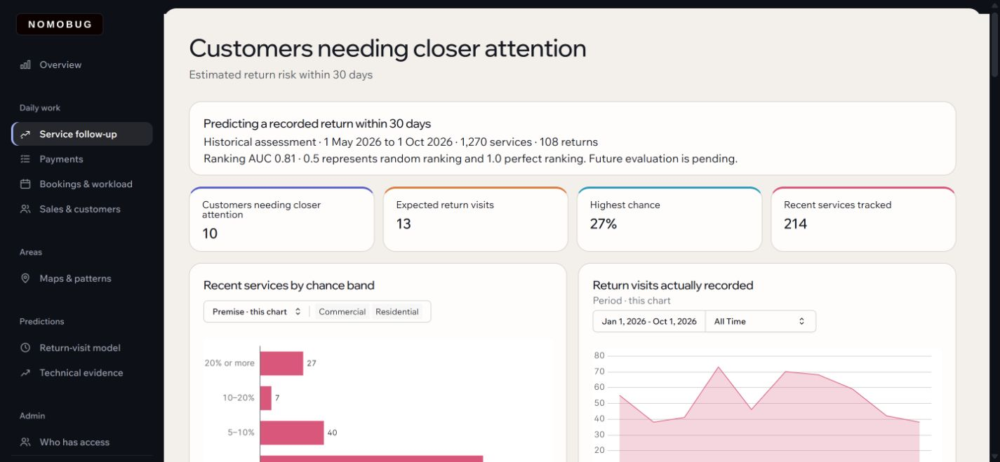
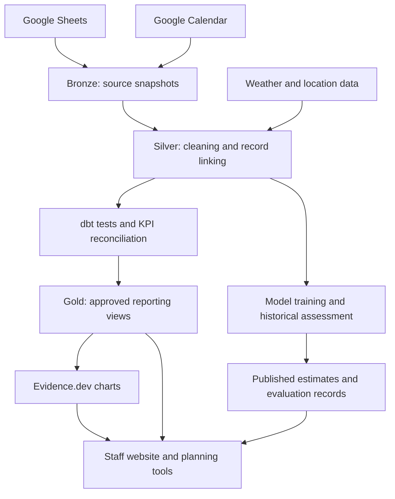

<div align="center">

# NOMOBUG
### Business analytics & service planning

A capstone project connecting sales, service bookings, payment reminders and predictive modelling in one management workspace.

[Management workspace](https://cp2-portal-fav22krh7q-as.a.run.app/) · [Project notebooks](notebooks/00_Project_Overview.ipynb) · [System documentation](planning/CP2_CURRENT_SYSTEM.md)


</div>

---

## The project

Nomobug's sales and service records live across Google Sheets and Google Calendar. This project brings those records together so management can understand business performance, prepare customer follow-ups and plan appointments with clearer evidence.

The system combines a protected staff website, an **Evidence.dev dashboard**, a validated BigQuery reporting pipeline and experimental prediction models. Customer records and credentials are kept outside the public repository.

## What management can do

| Area | What it provides |
| --- | --- |
| **Overview** | Sales, bookings and direct links to follow-up and planning tasks |
| **Service follow-up** | Estimated return risk, customer review and recorded follow-up results |
| **Payments** | Contract balances, reminder schedules and recorded refund summaries |
| **Bookings & workload** | Appointment calendar, team availability, booking forecasts and staffing estimates |
| **Sales & customers** | Package sales, customer segments, repeat purchases and area comparisons |
| **Maps & patterns** | Service concentrations, recorded pest returns and location coverage |
| **Model evidence** | Historical assessments, comparison methods, inputs and evaluation limitations |

**Reading the figures:** sales represent recorded package prices; reminder dates do not prove payment; Calendar bookings do not prove completed treatment. Model estimates do not determine warranty entitlement.

## Current workspace



Service follow-up shows the 30-day model assessment alongside estimated risk and recorded return trends. This capture shows aggregate figures from the deployed workspace.

## How it works



Docker packages the application and batch jobs. Cloud Run hosts the website and runs scheduled refreshes. Reporting is scheduled for **06:00 Malaysia time**, followed by the dashboard refresh at **06:45**. Google IAP protects access to the workspace and embedded reports.

Candidate reporting releases pass checks before the stable views are published. Runtime freshness and deployment status must be checked in the system; a saved report is a dated record.

## Prediction models

| Model | Question | Evidence |
| --- | --- | --- |
| **Pest-related return risk** | How likely is a recorded pest-related return within 30 days of a service? | Historical assessments and a separate frozen future test |
| **Booking forecast** | How many bookings should management expect over the next two weeks? | Historical forecasting comparisons and separately collected predictions |
| **Appointment-hour forecast** | How many team appointment hours should be planned for the next week? | Historical error comparisons and staffing estimates |

The return-risk model remains **experimental**. Historical ranking results, classification results and future evaluation describe different assessments and must be read separately. AUC measures ranking ability; it is not classification accuracy. More evaluation records improve confidence in the measurement, not automatically the model's performance.

Future results require timely predictions, complete outcome windows and coverage checks. Missed prediction windows remain recorded. See the [visual model guide](project_guide/models/index.html) and [current system record](planning/CP2_CURRENT_SYSTEM.md) for evidence and limitations.

### Historical performance

| Assessment | Sample | Result | Comparison |
| --- | --- | --- | --- |
| Return-risk ranking used in the workspace | 1,270 services, 108 recorded returns | **0.81 ROC AUC** (95% interval: 0.77–0.85). The highest-scoring fifth contained **62%** of returns. | A simple final-residential-service rule found **52%**; random selection found **21%** at the same review size. |
| Original frozen ExtraTrees model, historical holdout | 100 services, 5 recorded returns | **94% accuracy**, **0.891 ROC AUC**, **0.305 average precision**. The highest-scoring 20 services contained **4 of 5** returns. | Always predicting no return gave **95% accuracy** and detected zero returns. The corrected reference found **3 of 5** in its top 20. |
| Two-week booking forecast · Extra Trees | 13 overlapping forecast dates | **12.76 bookings MAE** | Historical baseline: **20.73 bookings MAE**. |
| Next-week booked hours · Ridge | 14 forecast dates | **8.97 hours MAE** | Historical baseline: **11.77 hours MAE**. |

**How to read these results:** AUC describes how well a score ranks services with returns above services without returns. MAE is the average absolute forecast error, in bookings or hours. The top-fifth comparison is a benchmark; staff can still follow up with everyone. The original holdout had only five returns, and the larger ranking assessment undercounted total returns by about 17%. The forecast results are historical and do not establish live performance.

[Return-risk ranking evidence](planning/CP2_PRESENTATION_STORY_20261103.md) · [Frozen model assessment](planning/CP2_CORRECTED_MODEL_CANDIDATES_V5.md) · [Forecast evidence](planning/CP2_MODEL_SEARCH_20261021.md)

## Explore the analysis

The notebooks follow the data from source records to model evaluation. Open them on GitHub or use the accompanying HTML copies locally. Saved results replay dated evidence; opening a notebook does not refresh live data.

| Notebook | Contents |
| --- | --- |
| [00 · Project overview](notebooks/00_Project_Overview.ipynb) | Project questions and analysis workflow |
| [01 · Data sources](notebooks/01_Data_Sources.ipynb) | Source structure and coverage |
| [02 · Data cleaning](notebooks/02_Data_Cleaning.ipynb) | Cleaning, classifications and record links |
| [03 · Outcomes & partitions](notebooks/03_Outcome_Labels_and_Partitions.ipynb) | Labels, eligibility and chronological splits |
| [04 · Predictors](notebooks/04_Predictors.ipynb) | Inputs and predictor testing |
| [05 · Pest-return model](notebooks/05_Pest_Return_Model.ipynb) | Model construction and assessment |
| [06 · Weekly planning](notebooks/06_Weekly_Planning_Models.ipynb) | Booking and appointment-hour forecasts |
| [07 · Experiments](notebooks/07_Model_Experiments.ipynb) | Candidate models and comparisons |
| [08 · Probability calibration](notebooks/08_Probability_Calibration.ipynb) | Probability reliability checks |
| [09 · Programme-end purchase](notebooks/09_Programme_End_Purchase.ipynb) | Additional purchase-prediction research |
| [10 · Commercial quotations](notebooks/10_Commercial_Quote_Model.ipynb) | Quotation-model research and data limits |

## Repository map

```text
notebooks/       Data exploration, cleaning and modelling chapters
scripts/         Extraction, transformations, training and operations
dbt/            Warehouse models and SQL tests
dashboard/      Evidence.dev pages, source queries and refresh job
webapp/         Staff website, APIs, calendar and follow-up tools
config/         Business rules, model pointers and evaluation protocols
deploy/         Container builds and deployment configuration
infra/          Infrastructure configuration and hosting experiments
tests/          Automated checks
project_guide/  File navigation and warehouse catalogues
planning/       Specifications, operations and dated evidence records
docs/           Academic deliverables available in the local workspace
```

Private source data, credentials, runtime exports and model receipts are excluded from public Git history. Some local guide links therefore require the original project workspace. For a more detailed map, open [Project Structure](project_guide/Project_Structure.md) or the local [searchable file guide](FILE_GUIDE.html).

## Development & checks

The application depends on private source configuration and Google Cloud access. Cloning the repository provides the source and documentation; it does not grant access to customer records or the hosted workspace.

For the Python checks used by CI:

```bash
python -m venv .venv
# Activate the environment for your operating system.
python -m pip install -r deploy/requirements-ci.txt
python -m pytest tests -q
```

For the Evidence dashboard, from `dashboard/`:

```bash
npm ci
npm run sources  # Requires authorised BigQuery access.
npm run dev
```

Use [.env.example](.env.example) as a configuration reference. Store real credentials outside Git. Read a script's help and the relevant protocol before running it: refresh, deployment and evaluation commands can change live state.

## Documentation

- [Current system & coverage](planning/CP2_CURRENT_SYSTEM.md)
- [Business metric definitions](BUSINESS_ANALYTICS.md)
- [Folder and script guide](project_guide/Project_Structure.md)
- [Warehouse release catalogue](planning/CP2_WAREHOUSE_RELEASE_CATALOGUE.md)
- [Notebook guide](notebooks/README.md)

Dated research and handovers are retained for traceability. They may describe older deployments or candidates that were never promoted.
