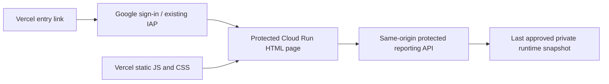

# Dashboard hosting

> Historical Vercel dashboard setup. The current management reports use [Evidence.dev](../dashboard/README.md).

Released 2 November 2026. Evidence: `outputs/dashboard_hosting/20261102/release.json`.

- Dashboard entry: https://cp2-dashboard-thevesh20-3384s-projects.vercel.app/
- Protected report: https://cp2-portal-fav22krh7q-as.a.run.app/reports
- Vercel project: `cp2-dashboard`, `prj_sQjCZfbZVYd8G40FE34n63mHxLzw`; Hobby, static files only.
- Vercel release: `dpl_Fno96NCGcdJbjqvZHChYiSKSjUhw`.
- Backend revision: `cp2-portal-00087-cep`, 100% normal service traffic. Previous `cp2-portal-00066-dk6` remains available for rollback and through the existing planning tag.
- Cloud Build: `6d0f51d6-e3f3-4e7a-bf2a-267353625f77`.

This release includes the current website source, including Claude's design and research-candidate pages. It does not promote those candidates into the frozen experiment or validate their outstanding modelling issues. The original Looker report remains accessible and unchanged.

## Verification and limits

761 Python tests passed. Hosted Overview, Sales, Visits and Payments were exercised. District filter totals were independently reconciled to the saved input. Browser console errors: none. Anonymous `/reports` and `/api/reporting` requests redirect to Google sign-in and expose no reporting data. IAP remains enabled. Cross-origin static asset hashes match the HTML's SHA-384 integrity pins; API connections remain same-origin. Vercel received no customer data or credentials.

The verified source release is `cp2r_20261027220023217d5b`; its 28 October freshness warning is visible. Hosting success does not imply that source collection or the daily reporting release has refreshed successfully. The next approved snapshot is consumed through the existing backend storage mechanism; this release did not run a source refresh.

No new paid plan or Cloud Run service was created. Vercel uses Hobby; existing Google Cloud usage and builds retain their existing billing rules. Do not describe the entire project as guaranteed zero-cost.

Rollback: route normal service traffic back to `cp2-portal-00066-dk6`. That revision lacks `/reports`; also revert the dashboard entry link or show a maintenance notice. Do not disable IAP to make rollback work. Keep deployment and source receipts.
