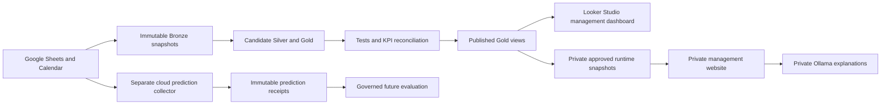

> Latest model collection audit (1 November): recovery coverage is incomplete — 24 missed eligible predictions and 16 unresolved candidate windows. Earlier zero-miss statements below describe older checkpoints. A fresh partial assessment of 14 matured, timely receipts found one return, no alerts, 92.9% accuracy equal to the always-no-return baseline, and 0% recall. See [current assessment](CP2_PARTIAL_EVALUATION_20261101.md).

# Nomobug management and decision-support system

Current submission report, evidence updated on 18 October 2026. Dashboard implementation is being completed by the project owner. Prospective results are pending; the final November addendum must record either a valid governed result or a completeness rejection. This report describes the implemented system and verified historical findings without claiming future evidence already exists.

## Project purpose

Nomobug's sales, service bookings and payment reminders are recorded in separate Google Sheets tabs and Google Calendars. These records answer different business questions and do not always agree. The project brings them into a checked reporting pipeline and provides management reporting, private operational tools and experimental predictive models.

The system is intended to help staff investigate sales by area, understand repeat purchases, look up a customer's linked programmes, review contract balances and reminder dates, and explore recorded pest-related returns. Sales are recorded package prices rather than profit. Calendar appointments are bookings rather than verified completed treatments. These distinctions control both the reporting definitions and the website's explanations.

## Data and business rules

Google Sheets and six approved Calendars are the operational sources. Immutable Bronze snapshots preserve the extracted records. Candidate Silver transformations normalise fields, link sales and appointments, and retain uncertain matches. Candidate Gold views calculate reporting metrics. Automated checks and independent KPI reconciliation must pass before the published views move to a candidate release. Failed refreshes retain the previous published release.

The business rules were clarified with the company during development. Commercial clients have no warranty regardless of pest or package. Residential standalone 1x purchases have no warranty. Residential 3x clients may claim within 30 days after the actual third paid service; rescheduling beyond 14 days does not automatically remove entitlement. Residential 4x, 6x and 12x clients have coverage during their service period and for 30 days after the last service, regardless of pest.

Owner-confirmed linked sales are treated as one programme where appropriate. A 1x purchase followed by an Upsell 2x can form a three-service programme. A verified 4-service and 20-service sale form a 24-service programme, while the earlier three-service sale remains separate. This prevents an upgrade from being counted automatically as a new repeat purchase.

Cancelled Calendar entries may preserve the old slot after rescheduling. Sunday is not a reliable cancellation or placeholder label because historical Sunday services exist. Uncertain or duplicate paid-session anchors remain explicit rather than being converted into completed work.

Recurring-payment follow-up uses Sales recorded paid amounts and the staff reminder schedule. The unreliable Payments tab is not used to establish settlement. A green reminder date means the date has passed; it proves neither payment, a sent reminder nor an overdue instalment. Contract schedules vary, so missing instalment dates are not invented. Undated refunds cannot support a monthly refund chart or an automatic deduction from sales.

## System architecture

Cloud Run hosts the reporting job, prediction collector, website and Ollama service. Cloud Scheduler triggers daily reporting at 06:00 Malaysia time and the experiment's two-minute collection checks. The frequent collector is separate because it must commit predictions within the declared service timing window; a daily reporting refresh cannot meet that requirement. Docker images package code and dependencies, while credentials, customer records and private runtime snapshots stay outside the images.

The private website complements Looker. Looker owns aggregate management reporting. The website adds customer lookup, contract follow-up, a custom geographic radius tool, experimental planning tools, and evidence-backed questions. Google IAP and a staff session protect private website access. The website's identity can invoke private Ollama and read approved snapshots; it cannot edit company sources. BigQuery operations are bounded at 100 MiB per query. Hosted state and immutable receipts allow cloud collection to continue without a running laptop.

The 2 November redesign reorganised the website around decisions. A Recommendations page ranks options generated from the business snapshot, saved planning evidence and the models, with adjustable weights for value, confidence, urgency and ease. A Performance page compares current figures with targets. Those targets (10% repeat rate, 15% warranty ceiling, 50% contract collection) are stored in `webapp/performance_targets.json` and are marked in the portal as targets to confirm until the owner approves them. Staff sign in with a username and password; IAP mode is unchanged.

## Pest-related return model

The primary prediction task is binary: whether a matched paid service is followed by a recorded corrective Calendar return in days 1–30 after its scheduled start date. A positive label is an operational return record. It is not necessarily a formal warranty claim or evidence of biological pest recurrence. Commercial services can have recorded returns even though commercial warranty entitlement is absent.

The frozen v5 ExtraTrees candidate uses 300 trees, maximum depth 10 and minimum leaf size 5. Its bundle records 93 model input features. Inputs cover available service and programme information, prior recorded service/return history, location and environmental context. Environmental associations are not interpreted as causal effects. The frozen final fit contains 5,695 historical service anchors, including 521 positives. The later fit must not be confused with the earlier historical held-out evaluation fit.

| Historical held-out result | Value |
|---|---:|
| Evaluated services | 100 |
| Recorded positive return windows | 5 |
| Fixed-threshold accuracy | 94% |
| Always-no-return accuracy on the same sample | 95% |
| True positives / false positives / false negatives | 2 / 3 / 3 |
| Positives captured in the original top 20 reviews | 4 of 5 |
| Nonpositive services in that review list | 16 |

The model's 94% accuracy is below the 95% majority-class baseline. Capturing four of five returns in the review list suggests a possible prioritisation use, but only five positives are insufficient to establish reliable performance. The model remains experimental. Geographic filters compare subsets of the same saved predictions; they do not retrain the model or establish improved future accuracy. The original held-out sample has reliable district assignments for 49 of 100 services, with the rest retained as unassigned.

## Additional predictive studies

### 17 October modelling and label audit update

A separate historical model was frozen using the same original 93-input Extra Trees configuration and a larger chronological assessment. Training used 1,506 services from March 2024–May 2025; validation used 1,177 services from July–November 2025; assessment used 2,075 services from January–August 2026, including 184 positive return windows. Property/programme groups were purged across partitions, with June and December outcome gaps. Model calibration and the 0.14 decision threshold were selected on validation only. Assessment precision was 23.0%, recall 64.7%, F1 34.0% and accuracy 77.7%, against 91.1% always-no-return accuracy. This was a separately trained model, not a larger unseen evaluation of the original final-fit weights. Prior exploration limits any claim of independence.

Calendar free-text notes contained severity, persistence/improvement, treatment and site-context mentions that a named-field-only screen had missed. A fixed-model paired comparison used the same 2,172 eligible validation services in three 2025 periods, including 206 positive windows. All-note inputs changed pooled precision from 23.9% to 26.6%, recall from 46.1% to 43.2% and F1 from 31.5% to 32.9%. False warnings fell from 302 to 246, while missed returns increased from 111 to 117. Probability error did not improve consistently. Notes edited after service end or with uncertain timing were excluded. These are text mentions rather than verified delivered treatment; the candidate was not adopted.

Recent pest-specific history, assigned-team changes and historical mapped food-place counts were also tested in the earlier development periods. None improved both ranking and probability error in every period. Historical food counts were retrieved for 68 sufficiently precise locations, covering 204 development services. Annual OpenStreetMap node counts represent approximate mapped context rather than a complete operating-business census.

A deterministic stratified audit checked 40 source-matched assessment windows: ten TP, FN, FP and TN cases each. Nineteen positive cases had warranty bookings supported by the owner's residential 3x numbering and 30-day coverage rule. One positive had a complimentary return without established formal warranty status. Twenty negatives had no candidate return recorded in the archived 30-day window. No definite label error was established in this sample. All sampled labels replayed against their archived event identities, but this does not prove actual treatment completion, biological recurrence, or absence of unrecorded problems. The sample is not a population label-accuracy estimate. Frozen models and prediction receipts were preserved.

The forecasting study compared 216 configurations across booking counts, package counts and recorded sales, with one- and four-week horizons. A development-selected boosting model achieved weekly-booking MAE 11.56 against a selected seasonal baseline of 23.00. A later sensitivity check found a stronger simple four-week average, with MAE 9.31. Because that baseline was identified after inspecting the test block, it is an experimental planning estimate requiring fresh forward validation. Its WAPE of 13.5% must not be presented as 86.5% classification accuracy.

The repeat-purchase study predicts whether a customer buys a different recorded paid programme within 90 days of their first recorded purchase. The final historical test contained 557 customers and 19 repeat buyers. The selected ranking found 13 of those 19 in 112 reviews, with 99 false alerts. Its 11.6% list precision and failure to meet the predeclared twenty-positive minimum prevent a dependable operational-performance claim. The website therefore shows an experimental priority list rather than calibrated purchase probabilities. A new 90-day future test cannot fully mature by 30 November.

### 2 November operational model search and warranty-risk model

The earlier studies left two weak points: the weekly forecasts were not clearly better than a simple average, and the repeat-purchase list had too few positives to support a performance claim. I ran a wider search on the 27 October portal snapshot (2,538 sales, 8,086 Calendar appointments, 1,404 located properties) to see whether more data or different configurations would produce a model that is both better than a simple alternative and useful to staff. The frozen pest-return model, its threshold and its 30 November evaluation were not changed.

| Question | Configurations | Held-out result | Decision |
|---|---:|---|---|
| Weekly bookings, warranty visits, paid visits, new sales and sales value | 28 per series plus 4 baselines | No configuration beat a 13-week moving average (between 1% better and 14% worse in MAE) | Not adopted |
| Time to repeat purchase (survival analysis) | 51 | C-index 0.764 against 0.773 for the existing 90-day ranking | Not adopted |
| Warranty visit within 30 days of a paid visit, per property | 16 plus 24 robustness variants | ROC AUC 0.767, average precision 0.300 against a 0.097 base rate | Selected |

The weekly models used 107 weeks of history, seven model families and four input sets, including calendar, public-holiday, Ramadan, rain and humidity inputs. Each model was refitted at every weekly origin. None of the extra inputs helped. With two years of weekly data, a 13-week average already captures most of the predictable level, and the planning forecasts that do beat their baselines rely on appointments booked ahead, which cannot be rebuilt historically from this snapshot. The survival models ranked customers about as well as the existing list but did not improve it, so the simpler list was kept.

The selected model answers a narrower question: after a paid service visit, will the same property need a warranty visit within 30 days? It uses only the property's own earlier visit history, such as earlier warranty visits, visits in the last 90 days and days since the previous visit. Pest, district, sale details and rain were tried and did not improve validation results. The model is an Extra Trees classifier with 200 trees, calibrated with Platt scaling on validation scores. Development used visits before January 2026, validation used January to April 2026 to choose the configuration, and the test block of May to September 2026 (1,104 visits, 107 warranty calls) was scored once.

On the test block, flagging the top 20% of visits caught 52% of warranty calls at 25% precision, a 2.6 times lift. The calibrated model expected 106.7 calls against 107 recorded, and a simple past-warranty-rate rule reached only AUC 0.55. Across 24 leaf and feature variants, test AUC stayed between 0.74 and 0.78; that grid was inspected after the choice and was not used to make it. The result means the model ranks properties usefully for proactive check-ins. It does not mean a flagged property will call back, since three in four do not, and a Calendar warranty signal is not proof that a treatment failed.

An independent review on 2 November found that this property-level model matches properties by rounded map position, lets some outcome windows cross partition boundaries, and that its saved forward record was created after part of the outcome period had started. It is therefore kept as research only, and the 2 November record is not reported as a prospective test.

Full study details are in `planning/CP2_OPERATIONAL_MODEL_SEARCH_20261102.md`.

### 3 November return-visit risk score and weekly check-in plan

I reframed the return task around the decision staff actually make: with limited time, which recently serviced customers should be checked first. The score uses the sale-linked service anchors exported on 1 November: 5,930 paid services from March 2024 to October 2026, of which 532 (9.0%) were followed by a recorded corrective return for the same sale within 30 days. Only 2.0% of first services were followed by a return, against 19.9% after the final service of a residential programme, so a rule that flags every final residential service was the comparison any model had to beat.

Partitions were fixed before fitting: development to 30 September 2025, validation 1 November 2025 to 31 March 2026, and a test from 1 May 2026, with 30-day gaps and no sale in two partitions. Inputs and regularisation were chosen on validation average precision only. The chosen logistic regression uses 13 inputs known before the visit; weather, humidity, season and area inputs did not improve validation results. It was refitted on development and validation data, frozen and scored once.

| Approach (1,270 test services, 108 returns) | AUC | Returns reached, top 10% | Top 20% | Top 30% |
|---|---:|---:|---:|---:|
| Random order | 0.50 | 8% | 21% | 31% |
| Rule: final residential service | 0.73 | 26% | 52% | 69% |
| Random forest, all inputs | 0.79 | 31% | 62% | 74% |
| **Return-visit risk score** | **0.81** | **35%** | **62%** | **78%** |

The AUC range was 0.77 to 0.85 and the gain over the rule at 20% effort ranged from 2 to 17 percentage points (bootstrap by sale). Summed over the test months the score expected 89 returns against 108 recorded, about 17% too low, so capacity plans keep a buffer. The portal scores every service whose 30-day window is still open from the pipeline’s predictor export, and staff set how many calls they can make; the plan picks the highest chances up to day 20, schedules each call from day 10 and reports the returns reached and hours to keep free. Staff record each check-in result (spoke with no issue, issue found and advice given, return visit booked, or no answer) in the internal action log; reached customers leave the plan, the log keeps the model's chance and day of the window at the time of the call, and these records are the pilot data. Whether early contact reduces returns has not been tested and needs that pilot. Full study: `outputs/model_validation/20261103_return_risk/Summary.md`.

## Prospective evaluation and collection incident

Predictions are stored before outcomes under fixed timing and integrity checks. The October 10 cohort is incomplete and remains visible. A reviewed deployment drift caused source-stage failures after B2B columns were added. The collector container was repaired and its full cloud source-to-model path verified. Later idle ticks alone were not treated as proof of scoring coverage.

All 23 flagged candidate windows were investigated: 16 are eligible under the current reconstruction, five have package or duplicate-session conflicts, one event was rescheduled, and one is absent from the current extraction. These findings do not prove the information available at every original prediction time. No late score was converted into a prospective prediction.

A separate recovery evaluation was declared and committed on 15 October before its first service day. It includes every eligible service dated 16–30 October under the same frozen model and collection timing. Complete outcomes through 29 November are required. Evaluation is scheduled for 30 November at 15:00 Malaysia time and must reject missing/late predictions, incomplete outcomes, changed evidence, eligibility drift or repeat evaluation. Its performance is currently unknown. The 16 October 11:30 collection audit reports one duplicate-session candidate requiring source review, with zero confirmed eligible misses at that check. The candidate must be resolved before claiming complete recovery-cohort coverage.

## Verification and remaining acceptance

The latest full Python suite passed 567 tests with 19 existing rasterio deprecation warnings. All 155 dbt data tests passed against the selected 16 October reporting release. Independent source-to-Gold reconciliation found no missing/unexpected rows or value mismatches in its checked measures. Frozen replay reproduced 5,695 service rows with negligible floating-point differences. Real-data API checks verified staff access requirements, the confirmed 4+20 programme link, empty searches, all 39 recurring contracts and their known amounts, date-filtered area totals, radius behaviour and planning outputs without individual probability exposure. The website rejects invalid date periods and mixed reporting releases, retains unknown payment amounts, and exposes custom-area date controls. Its staff-only map workspace adds sales density, Calendar warranty-signal density, uncertainty-aware proximity cells, pan/zoom, overlapping-record inspection and customer-history links. Historical model totals remain separate from the 85 mapped services. The full 100-service evaluation contains five returns; geographic missingness must not be hidden.

The assistant's hosted review identified a compound weather/profit question that was incorrectly routed to a sales ranking. The repaired response states both measurement limits. Green reminder-date interpretation and standard model comparisons use explicit verified evidence. Broader questions use Ollama and remain fallible; the small acceptance review is not a general AI accuracy result, and measured generation latency varied substantially.

The 16 October source-to-Gold reconciliation passed without row/value mismatches on the recorded release. Final submission still requires the owner's completed dashboard and final demonstration, current spending review, and the governed prospective evaluation or an explicit completeness failure. No customer-identifying screenshots should be placed in an unlisted or public submission without approval.

## 5 November changes and known limitations

**Reporting split.** Looker Studio is the single reporting surface for descriptive, predictive and prescriptive results. The daily reporting job copies the models' current answers into the BigQuery dataset `predictions` (return-visit chances with reasons and a suggested action, the two-week booking forecast with its likely range, past forecasts against actuals, and next week's staffing hours), so the dashboard reads model output like any other table. The website keeps only what a dashboard cannot do: recording check-in results, the custom radius tool, and the explanation of each model's method and accuracy.

**New inputs did not help.** Team (calendar), booked job length, days booked ahead, weekend jobs, salesperson return rate, returning-client flag and monthly billing were tested against return_risk_v1 with the same splits and validation-only selection. None improved validation average precision, and team was slightly worse, so the model is unchanged. The limit is the number of recorded returns, not missing inputs (`outputs/model_validation/20261105_new_inputs/Summary.md`).

**Check-in pilot not run.** A randomised pilot was declared on 4 November but the owner declined it before any call. There is therefore no evidence on whether early contact reduces returns. Routine check-ins recorded by staff can be reported as process counts only.

**Limitations to state in the final report.**
- The original frozen pest-return model's prospective cohorts are incomplete (40 and 24 eligible windows missed in the October 10 and recovery cohorts). The 30 November evaluations are expected to report a completeness failure, so no prospective accuracy is claimed.
- return_risk_v1 is supported by historical testing (AUC 0.81 on 1,270 services, 108 returns) and the monthly check (AUC 0.84 on 1 November data). Its May to October test block has now been viewed twice, so it is no longer an untouched test.
- The booking and hours forecasts beat a simple average on 13 and 14 historical windows; live accuracy is still being collected weekly. Performance targets on the website are working values until the owner confirms them.
- Only 46% of sales have a known district, 78% of services link to their sales context, and Calendar entries can be edited after the service date. Area and model figures describe the linked records only.

## Evidence records

The 18 October completion checks passed the full 635-test Python suite and repeated source-to-reporting reconciliation: all 16 checks passed on release `cp2r_20261017041003b1d038`, using 22 bounded BigQuery queries. Frozen replay reproduced all 5,695 training-service outputs within 3.4e-16 maximum probability difference. The current warehouse test result is recorded in the completion receipt. The portal release `cp2-portal-00044-6xv` uses smaller evidence prompts, preserves complete source evidence in citations and directly handles bookings-versus-demand measurement limits. One live generated source-checking answer completed in 14.8 seconds. This is a small acceptance example, not general AI accuracy or latency certification.

The project-specific billing report for 1–17 October showed MYR62.54 usage cost and MYR62.54 savings, producing a displayed subtotal of MYR0.00. Reporting can lag; savings do not mean the infrastructure has no underlying cost. No billing settings were changed. Client M's funding sale was confirmed by the owner as CUST1148. Metro's free-service explanation was retained. DC3's newer October sale was identified, with a blank phone field explaining the earlier-sale match. These clarifications do not backfill predictions or silently expand frozen eligibility. Frozen extraction limitations and original candidate records remain explicit.

The 18 October hosted browser pass verified payment filters and customer navigation, map selection/zoom/location drill-down, and two source-backed policy answers. It exposed a 45-second timeout for broader Ollama guidance. Readable customer programme labels and a source-backed hotspot-use answer were deployed and verified; the latter answered in about 250ms in the observed UI check. This improves common-question handling without establishing fast or reliable general generation. The updated Python suite passed 633 tests and the container smoke test passed. See `planning/CP2_WEBSITE_ACCEPTANCE_20261018.md` for scope and remaining limitations.

- `planning/CP2_VERIFICATION_20261017.md`: latest cloud and website checks, with live-browser limits.
- `outputs/model_validation/20261017_larger_frozen_test/`: separate larger historical assessment and its declared partition.
- `outputs/model_validation/20261017_calendar_free_notes/`: Calendar-note coverage and paired results.
- `outputs/model_validation/20261017_outcome_label_audit/`: 40-case source audit, owner-rule adjudication and private evidence.
- `outputs/project_audit/20261017_acceptance/`: current cloud state and real-snapshot website API checks.

- `config/cp2_model_current.json`: model registry, frozen bundle fingerprint and historical metrics.
- `planning/CP2_ADDITIONAL_MODEL_RESEARCH_20261015.md`: forecast and repeat-purchase protocols, comparisons and limitations.
- `planning/CP2_COLLECTION_AND_AI_RESOLUTION_20261015.md`: incident, candidate review and recovery declaration.
- `config/cp2_recovery_cohort.json`: predeclared recovery test.
- `outputs/portal_acceptance/20261015/api_acceptance.json`: aggregate real-data website acceptance receipt.
- `planning/CP2_WEBSITE_ACCEPTANCE_20261015.md`: final website deployment and browser checks.
